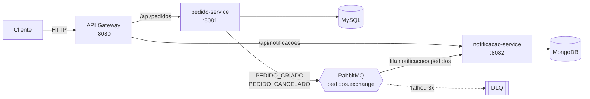

<h1 align="center">E-commerce · Microsserviços com Java e Spring Boot</h1>

<p align="center">
  <a href="../../actions/workflows/ci.yml"></a>
  
  
  
  
  
  
</p>

Back-end de pedidos de um e-commerce dividido em microsserviços. O cliente fala só com o **API Gateway**. O **pedido-service** grava no MySQL e publica um evento no **RabbitMQ**. O **notificacao-service** consome esse evento e registra a notificação no MongoDB. Os serviços não se chamam diretamente: a comunicação é assíncrona, por eventos.

## Arquitetura



| Serviço | Responsabilidade | Banco | Porta |
| --- | --- | --- | --- |
| api-gateway | Porta de entrada única, roteamento por caminho | — | 8080 |
| pedido-service | Criar, consultar e cancelar pedidos; publicar eventos | MySQL (relacional) | 8081 |
| notificacao-service | Consumir eventos e registrar notificações ao cliente | MongoDB (NoSQL) | 8082 |

## Decisões técnicas

- **Database per service:** cada microsserviço tem o seu banco. Pedido é dado estruturado e transacional (MySQL); notificação é um log de documentos (MongoDB).
- **Comunicação assíncrona com RabbitMQ:** o pedido-service não depende do notificacao-service estar no ar. Se a notificação falhar, o pedido continua criado.
- **Dead Letter Queue:** a mensagem que falha 3 vezes vai para `notificacoes.pedidos.dlq` em vez de se perder ou travar a fila.
- **Contrato por JSON:** cada serviço tem a sua própria classe do evento, sem compartilhar código. O conversor usa o tipo do parâmetro do listener, não o nome da classe do produtor.
- **Regra de negócio no domínio:** o cálculo do valor total e a regra "não cancelar duas vezes" ficam na entidade `Pedido`, não no controller.
- **Erros padronizados (RFC 7807):** `@RestControllerAdvice` devolve `ProblemDetail` com 400, 404 ou 422 e a lista de erros de validação.

**Padrões de projeto usados:** API Gateway, Publisher/Subscriber, Repository, DTO (records), Strategy (mensagem por tipo de evento) e Static Factory Method (`Pedido.novo`, `PedidoResponse.de`).

## Endpoints (pelo gateway)

| Método | Caminho | Descrição |
| --- | --- | --- |
| POST | `/api/pedidos` | Cria um pedido e publica `PEDIDO_CRIADO` |
| GET | `/api/pedidos` | Lista pedidos (filtro opcional `?status=CRIADO`) |
| GET | `/api/pedidos/{id}` | Busca um pedido |
| PATCH | `/api/pedidos/{id}/cancelar` | Cancela e publica `PEDIDO_CANCELADO` |
| GET | `/api/notificacoes?pedidoId={id}` | Notificações geradas para o pedido |

A documentação OpenAPI de cada serviço fica em `/swagger-ui.html` (portas 8081 e 8082).

## Como rodar

Pré-requisito: Docker. Um comando sobe os bancos, o RabbitMQ e os três serviços:

```bash
docker compose up --build
```

Teste o fluxo completo:

```bash
# 1. Criar um pedido
curl -X POST http://localhost:8080/api/pedidos \
  -H "Content-Type: application/json" \
  -d '{"cliente":"Luiz","emailCliente":"luiz@email.com","produto":"Monitor","quantidade":2,"valorUnitario":900.00}'

# 2. Ver a notificação gerada pelo evento
curl "http://localhost:8080/api/notificacoes?pedidoId=1"
```

O painel do RabbitMQ fica em http://localhost:15672 (usuário e senha `guest`).

## Testes

Testes unitários com **JUnit 5, Mockito e AssertJ**, além de testes da camada web com **MockMvc**. Eles rodam sem precisar de banco ou RabbitMQ:

```bash
mvn test
```

| Serviço | O que é testado |
| --- | --- |
| pedido-service | Regras do domínio, service com mocks (publicação de eventos), controller (201, 400 e 404) |
| notificacao-service | Montagem das mensagens por tipo de evento, gravação da notificação, listener |
| api-gateway | Registro das rotas |

O GitHub Actions roda os testes e constrói as imagens Docker a cada push.

## Estrutura

```
├── api-gateway/            # Spring Cloud Gateway
├── pedido-service/         # Spring Web + JPA + MySQL + AMQP
│   └── src/main/java/br/com/luizalves/pedido
│       ├── controller/     # REST + tratamento de erros
│       ├── service/        # casos de uso
│       ├── domain/         # entidade e regras de negócio
│       ├── repository/     # Spring Data JPA
│       ├── dto/            # records de entrada e saída
│       ├── event/          # evento e publisher
│       └── config/         # RabbitMQ
├── notificacao-service/    # Spring Web + MongoDB + AMQP
└── docker-compose.yml
```

## Próximos passos

- Testes de integração com Testcontainers (MySQL, MongoDB e RabbitMQ reais)
- Autenticação no gateway com JWT
- Circuit breaker com Resilience4j

## Autor

**Luiz Alves** · Desenvolvedor Java
[LinkedIn](https://www.linkedin.com/in/luiz-alves-candido-da-silva/) · [Portfólio](https://luizin16.github.io)
